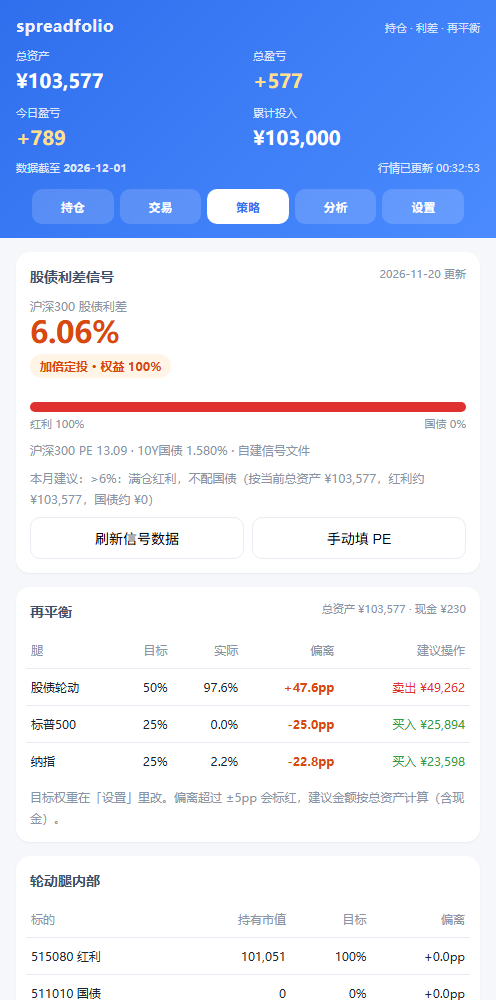

# Spreadfolio

> 一个记账本 + 一个策略看板：**记录持仓与交易、算收益与回撤、盯股债利差、提示再平衡**。
> 无后端、无服务器、数据在你自己的 GitHub 仓库里。



## 它能做什么

| 模块 | 功能 |
|---|---|
| 持仓 | 场内 ETF / 场外基金统一记录，自动市值、成本、浮动盈亏、仓位占比 |
| 交易 | 买入/卖出/入金/出金，支持 **CSV 导入券商对账单**（UTF-8/GBK，列名自动识别） |
| 收益 | 今日盈亏、总盈亏；时间加权净值曲线，**日频最大回撤**；近 1/2/3 月、1/2/3/5/10 年一键切换 |
| 策略 | **股债利差信号**（1/PE − 10Y 国债）→ 本月该持有多少红利，附金额建议 |
| 再平衡 | 目标 50/25/25 vs 实际权重，偏离超 ±5pp 标红，给出买卖金额 |
| 归因 | 每只标的的已实现 / 浮动盈亏与贡献占比 |
| 同步 | GitHub API 读写 `data.json`，或导出/导入 JSON |

## 架构

```
GitHub Actions（每交易日 18:30）
  └─ scripts/fetch_signal.py → 中证 PE + 东财 10Y → signal.json（自动提交）

浏览器（GitHub Pages）
  ├─ signal.json → 利差档位 / 目标仓位
  ├─ data.json   → 持仓 / 交易 / 入金
  ├─ 东财行情     → 基金净值（JSONP）
  └─ GitHub API  → 写回 data.json（token 存本机）
```

> 沪深300 PE 只有中证官网有，且不允许跨域，所以把取数放到 Action 里跑，前端只读静态 `signal.json`。

## 快速开始

```bash
# 本地预览（不能直接双击 html，fetch 需要 http）
python -m http.server 8000
# 打开 http://localhost:8000
```

上线：

1. 新建 GitHub 仓库，把本目录推上去
2. Settings → Pages → Source 选 `main` / root
3. Settings → Actions → General → Workflow permissions 选 **Read and write**（让机器人提交 signal.json）
4. 访问 `https://<用户名>.github.io/<仓库名>/`，手机上「添加到主屏幕」即可

## 目录

```
index.html            页面结构与样式
app.js                全部逻辑（行情 / 回放 / 指标 / 信号 / 再平衡 / 归因 / CSV / 同步）
data.json             你的数据
signal.json           自动生成的利差信号
scripts/fetch_signal.py
.github/workflows/update-signal.yml
test_logic.js         17 条逻辑单测
方案说明.md            详细文档（算法、CSV 格式、部署）
```

## 自测

```bash
node test_logic.js
# PASS ×17：买入、卖出、入金稀释、现金分红、份额拆分、回撤
```

## 免责

个人记账工具，不构成投资建议。行情来自东方财富/中证指数公开接口，可能延迟或中断。

---

**Spreadfolio** — *spread*（利差）+ *portfolio*（组合）。
