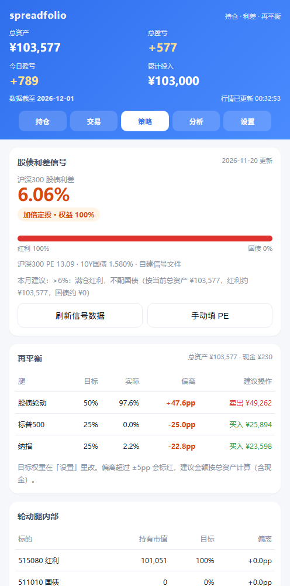

# Spreadfolio · 持仓记账 + 收益分析 + 策略联动

一个**没有后端**的单页应用：手机、电脑打开同一个网址；数据一个 JSON；每天由 GitHub Actions 自动算好股债利差。



---

## 一、架构

```
                    每天 18:30（GitHub Actions）
                              │
                    scripts/fetch_signal.py
                     ├─ 中证指数官网 → 沪深300 PE
                     └─ 东方财富     → 10Y 国债
                              │
                         signal.json（自动提交）
                              │
手机 / 电脑 ──打开网址──> 静态页面（GitHub Pages）
                              ├─ 读 signal.json（利差 / 目标仓位）
                              ├─ 读 data.json（持仓 / 交易 / 入金）
                              ├─ 拉行情（基金净值 + K线，JSONP）
                              └─ 写回 data.json（GitHub API，需 token）
```

**为什么这么设计**：中证官网的接口不允许浏览器跨域，所以 PE 不能在前端直接取；
把「取数」放到 GitHub Action 里跑，结果写成一个静态 `signal.json`，前端只读同目录文件——
**既自动，又不需要任何 token 暴露在浏览器里**。

---

## 二、功能清单

### 1. 持仓（场内 + 场外）
- 6 位代码统一处理（ETF / 场外基金都走东财净值接口，取不到再退回 K 线）
- 自动算：份额、成本、现价、市值、浮动盈亏、占比、现金
- 每只标的可以标「腿」（股债轮动 / 标普 / 纳指 / 其他），供再平衡使用

### 2. 交易与现金流
- 买入 / 卖出（日期、账户、份额、价格、费用）
- 入金 / 出金（正数入金、负数出金）
- **CSV 导入券商对账单**：自动识别日期/代码/方向/数量/价格/费用列，兼容 `买入/卖出/申购/赎回`、千分位、带引号字段；支持 UTF-8 与 GBK 编码（券商导出常见 GBK）
- 提供 CSV 模板下载

### 2.5 导入现有持仓（存量建仓）

券商导不出历史成交时，直接在「交易」页粘贴：

```
代码,名称,份额,成本价,建仓日期
515080,中证红利ETF,63700,1.568,2026-11-20
```

逗号 / 空格 / 制表符都行，可直接从 Excel 复制。导入时会**同时生成一笔等额入金**，
这样「累计投入」和「总盈亏」才是对的（否则现金会变成负数）。

### 3. 每日盈亏 / 总盈亏
- 今日盈亏 = 今日总资产 − 昨日总资产 − 今日入金
- 总盈亏 = 当前总资产 − 累计净投入
- 累计投入 = 所有入金 − 出金

### 4. 股债利差联动（新）
- 显示当前 **沪深300 PE、10Y 国债、利差**
- 自动判定档位并给出**本月该持有多少红利**：

| 利差 | 仓位 | 标签 |
|---|---|---|
| >6% | 红利 100% | 加倍定投 |
| 5~6% | 红利 70% / 国债 30% | 正常持有 |
| 4~5% | 红利 40% / 国债 60% | 降低权益 |
| ≤4% | 红利 0% / 国债 100% | 清仓权益 |

- 还给出**金额建议**：按当前总资产换算成“红利约 ¥X、国债约 ¥Y”
- 数据每天自动更新（`signal.json`）；取不到时可手动填 PE

### 5. 再平衡提醒（新）
- 目标 50 / 25 / 25（可在设置里改）
- 显示每条腿的**实际权重、偏离（pp）、建议买卖金额**
- 偏离超过 ±5pp 标红
- 另有一张「轮动腿内部」表：红利 vs 国债 的实际比例 vs 信号要求

### 6. 收益归因（新）
- 每只标的拆成：**已实现盈亏**（卖出部分相对成本，已扣费）+ **浮动盈亏**（市值 − 剩余成本）
- 按合计盈亏排序，并给出贡献占比

### 7. 收益曲线与区间指标
- 时间加权净值（TWR），剔除入金/出金影响
- 区间：近 1/2/3 月、1/2/3/5/10 年、全部
- 指标：区间收益、最大回撤（日频）、年化、波动
- 红色阴影标出回撤深度

### 8. 云同步
- GitHub API 拉取/上传 `data.json`（token 存本机）
- 导出 / 导入 JSON 兜底

---

## 三、关键算法

**回放**：从第一笔入金开始，逐日推进

```
每日市值 = Σ(份额 × 单位净值) + 现金
```

份额由交易累加；现金 = 入金 − 买入 + 卖出 − 费用 + 分红。

**净值（TWR）**

```
nav_t = nav_{t-1} × (V_t − CF_t) / V_{t-1}
```

只有入金/出金算外部现金流，买卖不算。所以每月定投 3000 不会把曲线“拉平”。

**分红与拆分**（同时存 px 与 tr 两条线）

| ratio = tr涨幅 ÷ px涨幅 | 判断 | 处理 |
|---|---|---|
| ≈1 | 正常 | 不动 |
| 1.002 ~ 1.15 | 现金分红 | 现金 += 份额 × 前日净值 × (ratio−1) |
| >1.15 | 份额拆分 | 份额 ×= ratio |

**归因**

```
已实现 = Σ 卖出份额 × (卖价 − 卖出时成本均价) − 费用
浮动   = 当前市值 − 剩余成本
```

**再平衡**

```
偏离(pp) = 实际权重 − 目标权重
建议金额  = 目标权重 × 总资产 − 该腿市值
```

---

## 数据私有（代码公开 + 数据放私有仓库）

公开仓库只放代码，持仓和金额放在另一个**私有仓库**里，页面用 token 通过 GitHub API 读写。

**1. 建私有仓库**

GitHub → New repository → 名字 `spreadfolio-data` → 选 **Private** → 勾 Add a README → Create。

进去新建 `data.json`，内容复制本仓库的 `data.template.json`。

**2. 生成最小权限 token**

GitHub → Settings → Developer settings → **Fine-grained tokens** → Generate new token：

- Repository access：**Only select repositories** → 只选 `spreadfolio-data`
- Permissions → **Contents: Read and write**（其余全部 No access）
- Expiration：90 天（到期重新生成）

**3. 页面里配置**

「设置」→ 数据仓库（私有）：

| 字段 | 填什么 |
|---|---|
| 仓库 | `你的用户名/spreadfolio-data` |
| Token | 刚才生成的 `github_pat_...` |
| 文件路径 | `data.json` |
| 自动同步 | 勾上（每次改动 1.5 秒后自动提交） |

点「保存本机配置」→「从云端拉取」，数据就接上了。

**换设备**：新设备打开网址 → 填同样三项 → 保存 → 拉取，数据回来。

> token 只存在浏览器 localStorage，不会上传到任何地方；但别在公共电脑上开自动同步。

## 四、部署（约 10 分钟）

1. 建 GitHub 仓库（如 `myportfolio`），把本目录所有文件推上去
2. Settings → Pages → Source 选 `main` / root → 保存
3. 等 1 分钟，访问 `https://你的用户名.github.io/myportfolio/`
4. 让 Actions 自动算信号：仓库 Settings → Actions → General → Workflow permissions 选 **Read and write**
   （`.github/workflows/update-signal.yml` 每个交易日 18:30 跑一次，更新 `signal.json`）

**手机访问**：浏览器打开网址 → 分享 → 添加到主屏幕，之后就是个 App。

**国内访问**：github.io 可能慢，可以换 Cloudflare Pages（连同一个仓库，Output directory 填 `/`）。

---

## 五、CSV 格式

最小可用列（顺序随意，表头关键字自动识别）：

```csv
日期,代码,名称,方向,数量,价格,费用
2026-11-20,515080,中证红利ETF,买入,63700,1.568,5
2026-12-01,040046,华安纳斯达克100,申购,315.4,4.755,2.25
```

- 「方向」支持：买入/卖出/申购/赎回/B/S
- 「价格」可留空，但要有「金额」列（会用 金额 ÷ 数量 兜底）
- 千分位、引号、制表符分隔都能识别

---

## 六、文件说明

| 文件 | 作用 |
|---|---|
| `index.html` | 页面结构与样式（响应式，手机优先） |
| `app.js` | 全部逻辑：行情、回放、指标、信号、再平衡、归因、CSV、同步 |
| `data.json` | 你的数据（示例：515080 + 场外纳指） |
| `signal.json` | 自动生成的利差信号（Actions 每天更新） |
| `scripts/fetch_signal.py` | 取 PE + 10Y，写 signal.json |
| `.github/workflows/update-signal.yml` | 每天定时跑上面的脚本并提交 |
| `test_logic.js` | 逻辑自测（node 跑，17 条用例全过） |
| `final_*.png` | 实机截图 |

---

## 七、已知限制

| 限制 | 影响 | 后续 |
|---|---|---|
| 场外基金净值 T-1 | 当日盈亏滞后一天 | 用 `fundgz` 实时估值补 |
| 分红按「现金入账」 | 若你选红利再投，份额与实际不符 | 加「分红再投」开关（按 ratio 增份额） |
| 关闭页面不更新 | 但重放能补历史 | 无需处理（价格历史在就能重算） |
| 券商 CSV 格式差异大 | 极端格式可能识别不了 | 加列映射界面 |
| Actions 免费额度 | 私有仓库每月 2000 分钟，够用 | 每天 1 次约 30 秒 |

---

## 八、自测

```bash
node portfolio/test_logic.js
# PASS ×17：买入、卖出、入金稀释、现金分红、份额拆分、回撤
```

CSV 解析另有覆盖：千分位、空价格、申购/赎回方向、日期格式。
